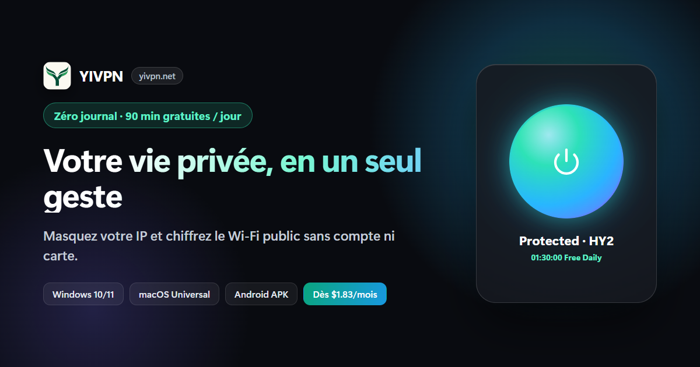

<p align="center">
  <a href="https://yivpn.net/fr/">
    
  </a>
</p>

<h1 align="center">YIVPN | VPN privé zéro log · 90 min/jour sans compte</h1>

<p align="center">
  [简体中文](./README.zh-CN.md) · [繁體中文](./README.zh-TW.md) · [English](./README.md) · [Русский](./README.ru.md) · [日本語](./README.ja.md) · [한국어](./README.ko.md) · [Español](./README.es.md) · [Français](./README.fr.md) · [Deutsch](./README.de.md) · [Português](./README.pt.md) · [Italiano](./README.it.md) · [Türkçe](./README.tr.md)
</p>

<p align="center">
  <a href="https://github.com/yivpn-official/yivpn/releases/tag/v1.0.9"></a>
  <a href="https://github.com/yivpn-official/yivpn/actions/workflows/verify.yml"></a>
  <a href="https://yivpn.net/fr/security/"></a>
  <a href="https://yivpn.net/fr/"></a>
</p>

---

VPN zéro log qui masque votre IP, protège vos DNS et chiffre le Wi-Fi public. 90 min gratuites/jour sans compte ni carte, 5 appareils, dès $1.83/mois.

- **Zéro journal d’activité**
- **90 min gratuites/jour · Sans compte**
- **Jusqu’à 5 appareils protégés**

## Official Downloads (v1.0.9)

| Platform | Official CDN | GitHub Release | SHA-256 Checksum |
| :--- | :--- | :--- | :--- |
| **Windows 10 / 11 (64-bit)** | [`YIVPN_1.0.9_x64.msi`](https://yivpn.net/downloads/YIVPN_1.0.9_x64.msi) (31.77 MiB) | [Download from GitHub](https://github.com/yivpn-official/yivpn/releases/download/v1.0.9/YIVPN_1.0.9_x64.msi) | `34f3c985ba4e0370…` ([full](https://github.com/yivpn-official/yivpn/releases/download/v1.0.9/YIVPN_1.0.9_x64.msi.sha256)) |
| **Windows 10 / 11 Portable (64-bit)** | [`YIVPN_1.0.9_x64_portable.zip`](https://yivpn.net/downloads/YIVPN_1.0.9_x64_portable.zip) (31.32 MiB) | [Download from GitHub](https://github.com/yivpn-official/yivpn/releases/download/v1.0.9/YIVPN_1.0.9_x64_portable.zip) | `65cbd6747c2151c2…` ([full](https://github.com/yivpn-official/yivpn/releases/download/v1.0.9/YIVPN_1.0.9_x64_portable.zip.sha256)) |
| **macOS 11+ (Apple Silicon & Intel Universal)** | [`YIVPN_1.0.9_universal.dmg`](https://yivpn.net/downloads/YIVPN_1.0.9_universal.dmg) (67.39 MiB) | [Download from GitHub](https://github.com/yivpn-official/yivpn/releases/download/v1.0.9/YIVPN_1.0.9_universal.dmg) | `c3fe6dd5c2faf35b…` ([full](https://github.com/yivpn-official/yivpn/releases/download/v1.0.9/YIVPN_1.0.9_universal.dmg.sha256)) |
| **Android 7.0+ (ARM64-v8a)** | [`YIVPN-Android-1.0.9-arm64-v8a.apk`](https://yivpn.net/downloads/YIVPN-Android-1.0.9-arm64-v8a.apk) (88.19 MiB) | [Download from GitHub](https://github.com/yivpn-official/yivpn/releases/download/v1.0.9/YIVPN-Android-1.0.9-arm64-v8a.apk) | `3eaa84d4dadcc010…` ([full](https://github.com/yivpn-official/yivpn/releases/download/v1.0.9/YIVPN-Android-1.0.9-arm64-v8a.apk.sha256)) |
| **iOS & iPadOS (15+)** | *iOS Coming Soon* | [Follow Releases](https://github.com/yivpn-official/yivpn/releases) | — |

## Verify Package Integrity (SHA-256)

```bash
# PowerShell (Windows)
Get-FileHash .\YIVPN_1.0.9_x64.msi -Algorithm SHA256

# macOS / Linux
shasum -a 256 YIVPN_1.0.9_universal.dmg

# Verify all published release manifests & remote SHA-256 digests
node scripts/verify-releases.mjs --remote
```

## Free Tier & Plans

- **Offre gratuite quotidienne · $0** — 1,5 heure (90 minutes) gratuite chaque jour · Smart Split inclus · Utilisation immédiate sans carte
- **1 mois**: **$2.99** (30 jours illimités · $2.99 / mois · ~$0.10 / jour)
- **3 mois**: **$6.99** (90 jours illimités · $2.33 / mois · ~$0.08 / jour)
- **6 mois**: **$12.99** (180 jours illimités · $2.17 / mois · ~$0.07 / jour)
- **12 mois**: **$21.99** (365 jours en toute sérénité · Seulement $1.83 / mois · $0.06 / jour)

## Official Links

- **Official Website**: [https://yivpn.net/fr/](https://yivpn.net/fr/)
- **Download Center & Checksums**: [https://yivpn.net/fr/download/](https://yivpn.net/fr/download/)
- **90-Min Daily Free VPN (No Sign-Up)**: [https://yivpn.net/fr/free-vpn/](https://yivpn.net/fr/free-vpn/)
- **Zero-Logs & Security Architecture**: [https://yivpn.net/fr/security/](https://yivpn.net/fr/security/)
- **Privacy Policy**: [https://yivpn.net/fr/privacy/](https://yivpn.net/fr/privacy/)
- **Smart Split Rules (Open Source)**: [github.com/yivpn-official/singbox-smart-split](https://github.com/yivpn-official/singbox-smart-split)
- **Local VPN MCP Server (Claude Code / Codex)**: [https://yivpn.net/fr/vpn-mcp/](https://yivpn.net/fr/vpn-mcp/)
- **Agent VPN API & CLI (Open Source)**: [github.com/yivpn-official/yivpn-agent-cli](https://github.com/yivpn-official/yivpn-agent-cli)
