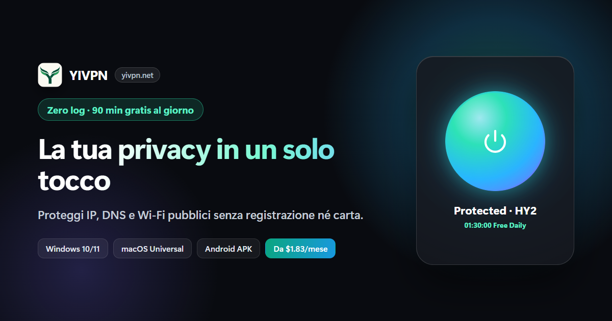

<p align="center">
  <a href="https://yivpn.net/it/">
    
  </a>
</p>

<h1 align="center">YIVPN | VPN Zero-Log Privata · 90 Min Gratis al Giorno</h1>

<p align="center">
  [简体中文](./README.zh-CN.md) · [繁體中文](./README.zh-TW.md) · [English](./README.md) · [Русский](./README.ru.md) · [日本語](./README.ja.md) · [한국어](./README.ko.md) · [Español](./README.es.md) · [Français](./README.fr.md) · [Deutsch](./README.de.md) · [Português](./README.pt.md) · [Italiano](./README.it.md) · [Türkçe](./README.tr.md)
</p>

<p align="center">
  <a href="https://github.com/yivpn-official/yivpn/releases/tag/v1.0.6"></a>
  <a href="https://github.com/yivpn-official/yivpn/actions/workflows/verify.yml"></a>
  <a href="https://yivpn.net/it/security/"></a>
  <a href="https://yivpn.net/it/"></a>
</p>

---

VPN zero-log per Windows, macOS e Android: protezione IP e DNS, Wi-Fi pubblico crittografato e 90 min gratis al giorno senza account né carta.

- **Zero log di attività**
- **90 min gratis/giorno · Senza account**
- **Fino a 5 dispositivi protetti**

## Official Downloads (v1.0.6)

| Platform | Official CDN | GitHub Release | SHA-256 Checksum |
| :--- | :--- | :--- | :--- |
| **Windows 10 / 11 (64-bit)** | [`YIVPN_1.0.6_x64.msi`](https://yivpn.net/downloads/YIVPN_1.0.6_x64.msi) (30.75 MiB) | [Download from GitHub](https://github.com/yivpn-official/yivpn/releases/download/v1.0.6/YIVPN_1.0.6_x64.msi) | `ce6c2781e48dc68a…` ([full](https://github.com/yivpn-official/yivpn/releases/download/v1.0.6/YIVPN_1.0.6_x64.msi.sha256)) |
| **Windows 10 / 11 Portable (64-bit)** | [`YIVPN_1.0.6_x64_portable.zip`](https://yivpn.net/downloads/YIVPN_1.0.6_x64_portable.zip) (30.30 MiB) | [Download from GitHub](https://github.com/yivpn-official/yivpn/releases/download/v1.0.6/YIVPN_1.0.6_x64_portable.zip) | `315ed29c681fccad…` ([full](https://github.com/yivpn-official/yivpn/releases/download/v1.0.6/YIVPN_1.0.6_x64_portable.zip.sha256)) |
| **macOS 11+ (Apple Silicon & Intel Universal)** | [`YIVPN_1.0.6_universal.dmg`](https://yivpn.net/downloads/YIVPN_1.0.6_universal.dmg) (66.18 MiB) | [Download from GitHub](https://github.com/yivpn-official/yivpn/releases/download/v1.0.6/YIVPN_1.0.6_universal.dmg) | `609a76e98e300f3c…` ([full](https://github.com/yivpn-official/yivpn/releases/download/v1.0.6/YIVPN_1.0.6_universal.dmg.sha256)) |
| **Android 7.0+ (ARM64-v8a)** | [`YIVPN-Android-1.0.6-arm64-v8a.apk`](https://yivpn.net/downloads/YIVPN-Android-1.0.6-arm64-v8a.apk) (87.09 MiB) | [Download from GitHub](https://github.com/yivpn-official/yivpn/releases/download/v1.0.6/YIVPN-Android-1.0.6-arm64-v8a.apk) | `1e001bd8c72b41ec…` ([full](https://github.com/yivpn-official/yivpn/releases/download/v1.0.6/YIVPN-Android-1.0.6-arm64-v8a.apk.sha256)) |
| **iOS & iPadOS (15+)** | *iOS Coming Soon* | [Follow Releases](https://github.com/yivpn-official/yivpn/releases) | — |

## Verify Package Integrity (SHA-256)

```bash
# PowerShell (Windows)
Get-FileHash .\YIVPN_1.0.6_x64.msi -Algorithm SHA256

# macOS / Linux
shasum -a 256 YIVPN_1.0.6_universal.dmg

# Verify all published release manifests & remote SHA-256 digests
node scripts/verify-releases.mjs --remote
```

## Free Tier & Plans

- **Piano gratuito giornaliero · $0** — 1,5 ore (90 minuti) gratis ogni giorno · Smart Split incluso · Subito pronto senza carta di credito
- **1 mese**: **$2.99** (30 giorni illimitati · $2.99 / mese · ~$0.10 / giorno)
- **3 mesi**: **$6.99** (90 giorni illimitati · $2.33 / mese · ~$0.08 / giorno)
- **6 mesi**: **$12.99** (180 giorni illimitati · $2.17 / mese · ~$0.07 / giorno)
- **12 mesi**: **$21.99** (365 giorni senza pensieri · Solo $1.83 / mese · $0.06 / giorno)

## Official Links

- **Official Website**: [https://yivpn.net/it/](https://yivpn.net/it/)
- **Download Center & Checksums**: [https://yivpn.net/it/download/](https://yivpn.net/it/download/)
- **90-Min Daily Free VPN (No Sign-Up)**: [https://yivpn.net/it/free-vpn/](https://yivpn.net/it/free-vpn/)
- **Zero-Logs & Security Architecture**: [https://yivpn.net/it/security/](https://yivpn.net/it/security/)
- **Privacy Policy**: [https://yivpn.net/it/privacy/](https://yivpn.net/it/privacy/)
- **Smart Split Rules (Open Source)**: [github.com/yivpn-official/singbox-smart-split](https://github.com/yivpn-official/singbox-smart-split)
- **Local VPN MCP Server (Claude Code / Codex)**: [https://yivpn.net/it/vpn-mcp/](https://yivpn.net/it/vpn-mcp/)
- **Agent VPN API & CLI (Open Source)**: [github.com/yivpn-official/yivpn-agent-cli](https://github.com/yivpn-official/yivpn-agent-cli)
