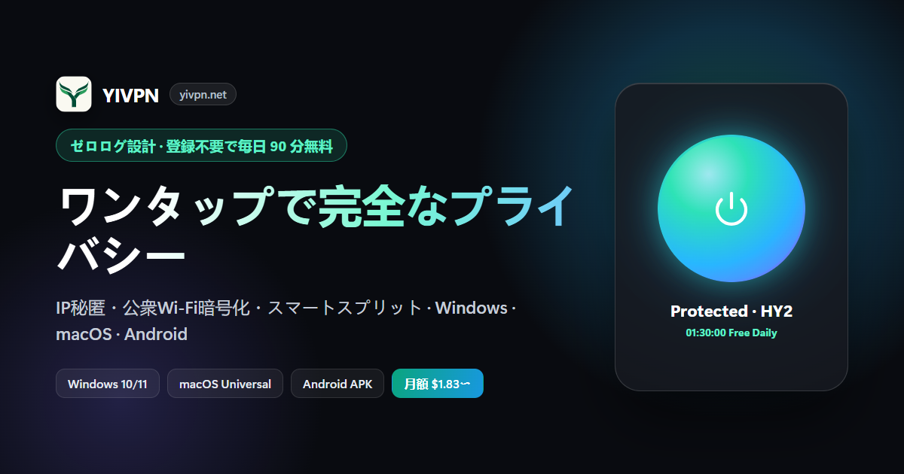

<p align="center">
  <a href="https://yivpn.net/ja/">
    
  </a>
</p>

<h1 align="center">YIVPN｜ゼロログ・公衆Wi-Fi暗号化VPN · 登録不要で毎日90分無料</h1>

<p align="center">
  [简体中文](./README.zh-CN.md) · [繁體中文](./README.zh-TW.md) · [English](./README.md) · [Русский](./README.ru.md) · [日本語](./README.ja.md) · [한국어](./README.ko.md) · [Español](./README.es.md) · [Français](./README.fr.md) · [Deutsch](./README.de.md) · [Português](./README.pt.md) · [Italiano](./README.it.md) · [Türkçe](./README.tr.md)
</p>

<p align="center">
  <a href="https://github.com/yivpn-official/yivpn/releases/tag/v1.0.6"></a>
  <a href="https://github.com/yivpn-official/yivpn/actions/workflows/verify.yml"></a>
  <a href="https://yivpn.net/ja/security/"></a>
  <a href="https://yivpn.net/ja/"></a>
</p>

---

完全ゼロログ設計でIPとDNSを保護し、公衆Wi-Fiを強力に暗号化する軽量VPN。登録・クレカ不要で毎日90分無料、スマートスプリット搭載、最大5台対応、月額$1.83〜。

- **通信ログ一切なし（ゼロログ）**
- **毎日 90 分無料 · 登録不要**
- **最大 5 台の端末を同時保護**

## Official Downloads (v1.0.6)

| Platform | Official CDN | GitHub Release | SHA-256 Checksum |
| :--- | :--- | :--- | :--- |
| **Windows 10 / 11 (64-bit)** | [`YIVPN_1.0.6_x64.msi`](https://yivpn.net/downloads/YIVPN_1.0.6_x64.msi) (30.75 MiB) | [Download from GitHub](https://github.com/yivpn-official/yivpn/releases/download/v1.0.6/YIVPN_1.0.6_x64.msi) | `ce6c2781e48dc68a…` ([full](https://github.com/yivpn-official/yivpn/releases/download/v1.0.6/YIVPN_1.0.6_x64.msi.sha256)) |
| **Windows 10 / 11 Portable (64-bit)** | [`YIVPN_1.0.6_x64_portable.zip`](https://yivpn.net/downloads/YIVPN_1.0.6_x64_portable.zip) (30.30 MiB) | [Download from GitHub](https://github.com/yivpn-official/yivpn/releases/download/v1.0.6/YIVPN_1.0.6_x64_portable.zip) | `315ed29c681fccad…` ([full](https://github.com/yivpn-official/yivpn/releases/download/v1.0.6/YIVPN_1.0.6_x64_portable.zip.sha256)) |
| **macOS 11+ (Apple Silicon & Intel Universal)** | [`YIVPN_1.0.6_universal.dmg`](https://yivpn.net/downloads/YIVPN_1.0.6_universal.dmg) (66.18 MiB) | [Download from GitHub](https://github.com/yivpn-official/yivpn/releases/download/v1.0.6/YIVPN_1.0.6_universal.dmg) | `609a76e98e300f3c…` ([full](https://github.com/yivpn-official/yivpn/releases/download/v1.0.6/YIVPN_1.0.6_universal.dmg.sha256)) |
| **Android 7.0+ (ARM64-v8a)** | [`YIVPN-Android-1.0.6-arm64-v8a.apk`](https://yivpn.net/downloads/YIVPN-Android-1.0.6-arm64-v8a.apk) (87.09 MiB) | [Download from GitHub](https://github.com/yivpn-official/yivpn/releases/download/v1.0.6/YIVPN-Android-1.0.6-arm64-v8a.apk) | `1e001bd8c72b41ec…` ([full](https://github.com/yivpn-official/yivpn/releases/download/v1.0.6/YIVPN-Android-1.0.6-arm64-v8a.apk.sha256)) |
| **iOS & iPadOS (15+)** | *iOS Coming Soon* | [Follow Releases](https://github.com/yivpn-official/yivpn/releases) | — |

## Verify Package Integrity (SHA-256)

```bash
# PowerShell (Windows)
Get-FileHash .\YIVPN_1.0.6_x64.msi -Algorithm SHA256

# macOS / Linux
shasum -a 256 YIVPN_1.0.6_universal.dmg

# Verify all published release manifests & remote SHA-256 digests
node scripts/verify-releases.mjs --remote
```

## Free Tier & Plans

- **デイリー無料プラン · $0** — 毎日 1.5 時間（90 分）無料 · スマートスプリット対応 · クレカ登録なしですぐ利用可能
- **1 ヶ月プラン**: **$2.99** (30 日間無制限 · $2.99 / 月 · 約 $0.10 / 日)
- **3 ヶ月プラン**: **$6.99** (90 日間無制限 · $2.33 / 月 · 約 $0.08 / 日)
- **6 ヶ月プラン**: **$12.99** (180 日間無制限 · $2.17 / 月 · 約 $0.07 / 日)
- **12 ヶ月プラン**: **$21.99** (365 日間たっぷり安心 · 月あたり $1.83 · 1 日わずか $0.06)

## Official Links

- **Official Website**: [https://yivpn.net/ja/](https://yivpn.net/ja/)
- **Download Center & Checksums**: [https://yivpn.net/ja/download/](https://yivpn.net/ja/download/)
- **90-Min Daily Free VPN (No Sign-Up)**: [https://yivpn.net/ja/free-vpn/](https://yivpn.net/ja/free-vpn/)
- **Zero-Logs & Security Architecture**: [https://yivpn.net/ja/security/](https://yivpn.net/ja/security/)
- **Privacy Policy**: [https://yivpn.net/ja/privacy/](https://yivpn.net/ja/privacy/)
- **Smart Split Rules (Open Source)**: [github.com/yivpn-official/singbox-smart-split](https://github.com/yivpn-official/singbox-smart-split)
- **Local VPN MCP Server (Claude Code / Codex)**: [https://yivpn.net/ja/vpn-mcp/](https://yivpn.net/ja/vpn-mcp/)
- **Agent VPN API & CLI (Open Source)**: [github.com/yivpn-official/yivpn-agent-cli](https://github.com/yivpn-official/yivpn-agent-cli)
