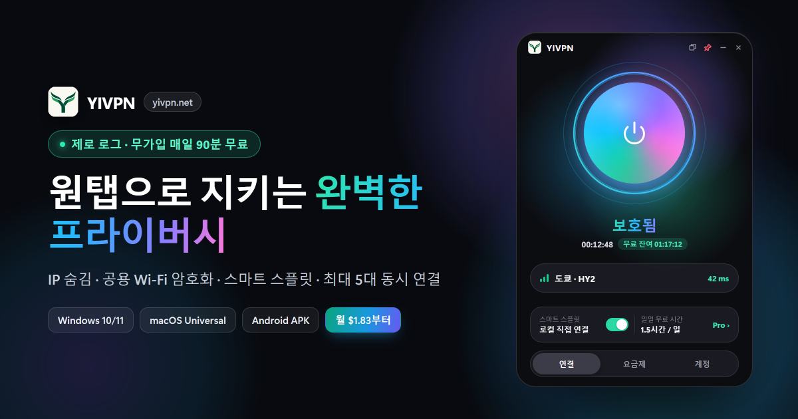

<p align="center">
  <a href="https://yivpn.net/ko/">
    
  </a>
</p>

<h1 align="center">YIVPN | 제로 로그 프라이버시 VPN · 무가입 매일 90분 무료</h1>

<p align="center">
  [简体中文](./README.zh-CN.md) · [繁體中文](./README.zh-TW.md) · [English](./README.md) · [Русский](./README.ru.md) · [日本語](./README.ja.md) · [한국어](./README.ko.md) · [Español](./README.es.md) · [Français](./README.fr.md) · [Deutsch](./README.de.md) · [Português](./README.pt.md) · [Italiano](./README.it.md) · [Türkçe](./README.tr.md)
</p>

<p align="center">
  <a href="https://github.com/yivpn-official/yivpn/releases/tag/v1.0.8"></a>
  <a href="https://github.com/yivpn-official/yivpn/actions/workflows/verify.yml"></a>
  <a href="https://yivpn.net/ko/security/"></a>
  <a href="https://yivpn.net/ko/"></a>
</p>

---

제로 로그 설계로 IP·DNS를 보호하고 공용 Wi-Fi를 암호화하는 VPN. 무가입·무카드 매일 90분 무료, 스마트 스플릿 및 최대 5대 동시 보호, 월 $1.83부터.

- **활동 기록 제로 로그**
- **매일 90분 무료 · 무가입**
- **최대 5대 기기 동시 보호**

## Official Downloads (v1.0.8)

| Platform | Official CDN | GitHub Release | SHA-256 Checksum |
| :--- | :--- | :--- | :--- |
| **Windows 10 / 11 (64-bit)** | [`YIVPN_1.0.8_x64.msi`](https://yivpn.net/downloads/YIVPN_1.0.8_x64.msi) (30.78 MiB) | [Download from GitHub](https://github.com/yivpn-official/yivpn/releases/download/v1.0.8/YIVPN_1.0.8_x64.msi) | `768225f8080e98de…` ([full](https://github.com/yivpn-official/yivpn/releases/download/v1.0.8/YIVPN_1.0.8_x64.msi.sha256)) |
| **Windows 10 / 11 Portable (64-bit)** | [`YIVPN_1.0.8_x64_portable.zip`](https://yivpn.net/downloads/YIVPN_1.0.8_x64_portable.zip) (30.33 MiB) | [Download from GitHub](https://github.com/yivpn-official/yivpn/releases/download/v1.0.8/YIVPN_1.0.8_x64_portable.zip) | `f4f53c76d38bea17…` ([full](https://github.com/yivpn-official/yivpn/releases/download/v1.0.8/YIVPN_1.0.8_x64_portable.zip.sha256)) |
| **macOS 11+ (Apple Silicon & Intel Universal)** | [`YIVPN_1.0.8_universal.dmg`](https://yivpn.net/downloads/YIVPN_1.0.8_universal.dmg) (66.24 MiB) | [Download from GitHub](https://github.com/yivpn-official/yivpn/releases/download/v1.0.8/YIVPN_1.0.8_universal.dmg) | `6eedffa696ae3db6…` ([full](https://github.com/yivpn-official/yivpn/releases/download/v1.0.8/YIVPN_1.0.8_universal.dmg.sha256)) |
| **Android 7.0+ (ARM64-v8a)** | [`YIVPN-Android-1.0.8-arm64-v8a.apk`](https://yivpn.net/downloads/YIVPN-Android-1.0.8-arm64-v8a.apk?b=20261119v2) (94.32 MiB) | [Download from GitHub](https://github.com/yivpn-official/yivpn/releases/download/v1.0.8/YIVPN-Android-1.0.8-arm64-v8a.apk) | `f226dad3b04dafe6…` ([full](https://github.com/yivpn-official/yivpn/releases/download/v1.0.8/YIVPN-Android-1.0.8-arm64-v8a.apk.sha256)) |
| **iOS & iPadOS (15+)** | *iOS Coming Soon* | [Follow Releases](https://github.com/yivpn-official/yivpn/releases) | — |

## Verify Package Integrity (SHA-256)

```bash
# PowerShell (Windows)
Get-FileHash .\YIVPN_1.0.8_x64.msi -Algorithm SHA256

# macOS / Linux
shasum -a 256 YIVPN_1.0.8_universal.dmg

# Verify all published release manifests & remote SHA-256 digests
node scripts/verify-releases.mjs --remote
```

## Free Tier & Plans

- **일일 무료 플랜 · $0** — 매일 1.5시간(90분) 무료 · 스마트 스플릿 기본 제공 · 카드 등록 없이 즉시 사용
- **1개월**: **$2.99** (30일 무제한 이용 · $2.99 / 월 · 약 $0.10 / 일)
- **3개월**: **$6.99** (90일 무제한 이용 · $2.33 / 월 · 약 $0.08 / 일)
- **6개월**: **$12.99** (180일 무제한 이용 · $2.17 / 월 · 약 $0.07 / 일)
- **12개월**: **$21.99** (365일 걱정 없는 무제한 · 월 $1.83 수준 · 하루 $0.06)

## Official Links

- **Official Website**: [https://yivpn.net/ko/](https://yivpn.net/ko/)
- **Download Center & Checksums**: [https://yivpn.net/ko/download/](https://yivpn.net/ko/download/)
- **90-Min Daily Free VPN (No Sign-Up)**: [https://yivpn.net/ko/free-vpn/](https://yivpn.net/ko/free-vpn/)
- **Zero-Logs & Security Architecture**: [https://yivpn.net/ko/security/](https://yivpn.net/ko/security/)
- **Privacy Policy**: [https://yivpn.net/ko/privacy/](https://yivpn.net/ko/privacy/)
- **Smart Split Rules (Open Source)**: [github.com/yivpn-official/singbox-smart-split](https://github.com/yivpn-official/singbox-smart-split)
- **Local VPN MCP Server (Claude Code / Codex)**: [https://yivpn.net/ko/vpn-mcp/](https://yivpn.net/ko/vpn-mcp/)
- **Agent VPN API & CLI (Open Source)**: [github.com/yivpn-official/yivpn-agent-cli](https://github.com/yivpn-official/yivpn-agent-cli)
