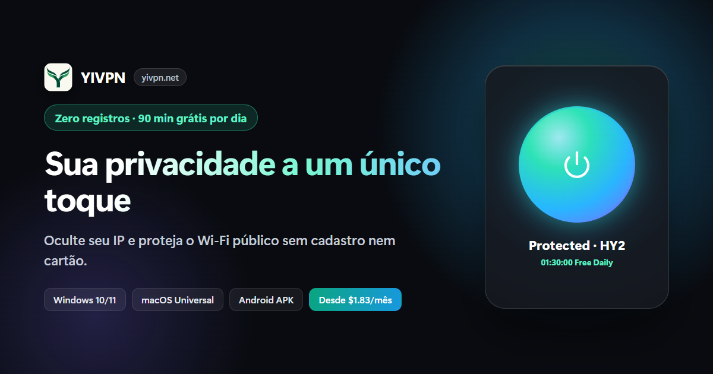

<p align="center">
  <a href="https://yivpn.net/pt/">
    
  </a>
</p>

<h1 align="center">YIVPN | VPN Privada Zero-Logs · 90 Min Grátis por Dia</h1>

<p align="center">
  [简体中文](./README.zh-CN.md) · [繁體中文](./README.zh-TW.md) · [English](./README.md) · [Русский](./README.ru.md) · [日本語](./README.ja.md) · [한국어](./README.ko.md) · [Español](./README.es.md) · [Français](./README.fr.md) · [Deutsch](./README.de.md) · [Português](./README.pt.md) · [Italiano](./README.it.md) · [Türkçe](./README.tr.md)
</p>

<p align="center">
  <a href="https://github.com/yivpn-official/yivpn/releases/tag/v1.0.4"></a>
  <a href="https://github.com/yivpn-official/yivpn/actions/workflows/verify.yml"></a>
  <a href="https://yivpn.net/pt/security/"></a>
  <a href="https://yivpn.net/pt/"></a>
</p>

---

VPN zero-logs para Windows, macOS e Android: proteção de IP e DNS, Wi-Fi público criptografado e 90 min grátis por dia sem cadastro nem cartão.

- **Zero registros de atividade**
- **90 min grátis/dia · Sem cadastro**
- **Até 5 dispositivos protegidos**

## Official Downloads (v1.0.4)

| Platform | Official CDN | GitHub Release | SHA-256 Checksum |
| :--- | :--- | :--- | :--- |
| **Windows 10 / 11 (64-bit)** | [`YIVPN_1.0.4_x64.msi`](https://yivpn.net/downloads/YIVPN_1.0.4_x64.msi) (30.42 MiB) | [Download from GitHub](https://github.com/yivpn-official/yivpn/releases/download/v1.0.4/YIVPN_1.0.4_x64.msi) | `76db69b44b694eda…` ([full](https://github.com/yivpn-official/yivpn/releases/download/v1.0.4/YIVPN_1.0.4_x64.msi.sha256)) |
| **Windows 10 / 11 Portable (64-bit)** | [`YIVPN_1.0.4_x64_portable.zip`](https://yivpn.net/downloads/YIVPN_1.0.4_x64_portable.zip) (29.97 MiB) | [Download from GitHub](https://github.com/yivpn-official/yivpn/releases/download/v1.0.4/YIVPN_1.0.4_x64_portable.zip) | `6e85e0905459382c…` ([full](https://github.com/yivpn-official/yivpn/releases/download/v1.0.4/YIVPN_1.0.4_x64_portable.zip.sha256)) |
| **macOS 11+ (Apple Silicon & Intel Universal)** | [`YIVPN_1.0.4_universal.dmg`](https://yivpn.net/downloads/YIVPN_1.0.4_universal.dmg) (65.47 MiB) | [Download from GitHub](https://github.com/yivpn-official/yivpn/releases/download/v1.0.4/YIVPN_1.0.4_universal.dmg) | `c7c12af7da5ce09a…` ([full](https://github.com/yivpn-official/yivpn/releases/download/v1.0.4/YIVPN_1.0.4_universal.dmg.sha256)) |
| **Android 7.0+ (ARM64-v8a)** | [`YIVPN-Android-1.0.4-arm64-v8a.apk`](https://yivpn.net/downloads/YIVPN-Android-1.0.4-arm64-v8a.apk) (86.32 MiB) | [Download from GitHub](https://github.com/yivpn-official/yivpn/releases/download/v1.0.4/YIVPN-Android-1.0.4-arm64-v8a.apk) | `040b52d03fe631f5…` ([full](https://github.com/yivpn-official/yivpn/releases/download/v1.0.4/YIVPN-Android-1.0.4-arm64-v8a.apk.sha256)) |
| **iOS & iPadOS (15+)** | *iOS Coming Soon* | [Follow Releases](https://github.com/yivpn-official/yivpn/releases) | — |

## Verify Package Integrity (SHA-256)

```bash
# PowerShell (Windows)
Get-FileHash .\YIVPN_1.0.4_x64.msi -Algorithm SHA256

# macOS / Linux
shasum -a 256 YIVPN_1.0.4_universal.dmg

# Verify all published release manifests & remote SHA-256 digests
node scripts/verify-releases.mjs --remote
```

## Free Tier & Plans

- **Plano gratuito diário · $0** — 1,5 hora (90 minutos) grátis por dia · Smart Split incluso · Uso imediato sem cartão de crédito
- **1 mês**: **$2.99** (30 dias ilimitados · $2.99 / mês · ~$0.10 / dia)
- **3 meses**: **$6.99** (90 dias ilimitados · $2.33 / mês · ~$0.08 / dia)
- **6 meses**: **$12.99** (180 dias ilimitados · $2.17 / mês · ~$0.07 / dia)
- **12 meses**: **$21.99** (365 dias sem preocupações · Apenas $1.83 / mês · $0.06 / dia)

## Official Links

- **Official Website**: [https://yivpn.net/pt/](https://yivpn.net/pt/)
- **Download Center & Checksums**: [https://yivpn.net/pt/download/](https://yivpn.net/pt/download/)
- **90-Min Daily Free VPN (No Sign-Up)**: [https://yivpn.net/pt/free-vpn/](https://yivpn.net/pt/free-vpn/)
- **Zero-Logs & Security Architecture**: [https://yivpn.net/pt/security/](https://yivpn.net/pt/security/)
- **Privacy Policy**: [https://yivpn.net/pt/privacy/](https://yivpn.net/pt/privacy/)
- **Smart Split Rules (Open Source)**: [github.com/yivpn-official/singbox-smart-split](https://github.com/yivpn-official/singbox-smart-split)
