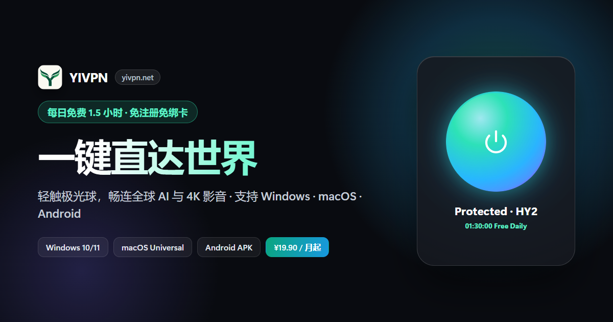

<p align="center">
  <a href="https://yivpn.net/">
    
  </a>
</p>

<h1 align="center">YIVPN（易VPN）｜一键直达全球网络 · 每天免费 1.5 小时</h1>

<p align="center">
  [简体中文](./README.zh-CN.md) · [繁體中文](./README.zh-TW.md) · [English](./README.md) · [Русский](./README.ru.md) · [日本語](./README.ja.md) · [한국어](./README.ko.md) · [Español](./README.es.md) · [Français](./README.fr.md) · [Deutsch](./README.de.md) · [Português](./README.pt.md) · [Italiano](./README.it.md) · [Türkçe](./README.tr.md)
</p>

<p align="center">
  <a href="https://github.com/yivpn-official/yivpn/releases/tag/v1.0.9"></a>
  <a href="https://github.com/yivpn-official/yivpn/actions/workflows/verify.yml"></a>
  <a href="https://yivpn.net/security/"></a>
  <a href="https://yivpn.net/"></a>
</p>

---

YIVPN（易VPN）是基于 sing-box 的轻量跨平台 VPN 客户端：免注册免绑卡每天免费 90 分钟，内置智能分流，支持 Windows、macOS、Android 最多 5 台设备同享。

- **每天免费 90 分钟**
- **最多 5 台设备同享**
- **全天候低延迟秒连**

## 全平台官方下载 (v1.0.9)

| 支持平台 | 官网高速直连 | GitHub 分发源 | SHA-256 哈希校验 |
| :--- | :--- | :--- | :--- |
| **Windows 10 / 11 (64-bit)** | [`YIVPN_1.0.9_x64.msi`](https://yivpn.net/downloads/YIVPN_1.0.9_x64.msi) (31.77 MiB) | [Download from GitHub](https://github.com/yivpn-official/yivpn/releases/download/v1.0.9/YIVPN_1.0.9_x64.msi) | `34f3c985ba4e0370…` ([full](https://github.com/yivpn-official/yivpn/releases/download/v1.0.9/YIVPN_1.0.9_x64.msi.sha256)) |
| **Windows 10 / 11 Portable (64-bit)** | [`YIVPN_1.0.9_x64_portable.zip`](https://yivpn.net/downloads/YIVPN_1.0.9_x64_portable.zip) (31.32 MiB) | [Download from GitHub](https://github.com/yivpn-official/yivpn/releases/download/v1.0.9/YIVPN_1.0.9_x64_portable.zip) | `65cbd6747c2151c2…` ([full](https://github.com/yivpn-official/yivpn/releases/download/v1.0.9/YIVPN_1.0.9_x64_portable.zip.sha256)) |
| **macOS 11+ (Apple Silicon & Intel Universal)** | [`YIVPN_1.0.9_universal.dmg`](https://yivpn.net/downloads/YIVPN_1.0.9_universal.dmg) (67.39 MiB) | [Download from GitHub](https://github.com/yivpn-official/yivpn/releases/download/v1.0.9/YIVPN_1.0.9_universal.dmg) | `c3fe6dd5c2faf35b…` ([full](https://github.com/yivpn-official/yivpn/releases/download/v1.0.9/YIVPN_1.0.9_universal.dmg.sha256)) |
| **Android 7.0+ (ARM64-v8a)** | [`YIVPN-Android-1.0.9-arm64-v8a.apk`](https://yivpn.net/downloads/YIVPN-Android-1.0.9-arm64-v8a.apk) (88.19 MiB) | [Download from GitHub](https://github.com/yivpn-official/yivpn/releases/download/v1.0.9/YIVPN-Android-1.0.9-arm64-v8a.apk) | `3eaa84d4dadcc010…` ([full](https://github.com/yivpn-official/yivpn/releases/download/v1.0.9/YIVPN-Android-1.0.9-arm64-v8a.apk.sha256)) |
| **iOS & iPadOS (15+)** | *iOS Coming Soon* | [Follow Releases](https://github.com/yivpn-official/yivpn/releases) | — |

## 安装包完整性校验 (SHA-256)

```bash
# PowerShell (Windows)
Get-FileHash .\YIVPN_1.0.9_x64.msi -Algorithm SHA256

# macOS / Linux
shasum -a 256 YIVPN_1.0.9_universal.dmg

# Verify all published release manifests & remote SHA-256 digests
node scripts/verify-releases.mjs --remote
```

## 每日免费额度与会员方案

- **日常免费版 · ¥0** — 每天 1.5 小时（90 分钟）免费连接时长 · 含国内外智能分流 · 下载即用无需绑卡
- **1 个月会员**: **¥19.90** (30 天畅享 · 折合 ¥19.90 / 月 · 约 ¥0.66 / 天)
- **3 个月会员**: **¥49.90** (90 天畅享 · 折合 ¥16.63 / 月 · 约 ¥0.55 / 天)
- **6 个月会员**: **¥89.90** (180 天畅享 · 折合 ¥14.98 / 月 · 约 ¥0.50 / 天)
- **12 个月会员**: **¥159.90** (365 天全年无忧 · 折合仅 ¥13.33 / 月 · 每天仅 ¥0.44)

## 官方入口

- **YIVPN 官方网站**: [https://yivpn.net/](https://yivpn.net/)
- **下载与 SHA-256 校验中心**: [https://yivpn.net/download/](https://yivpn.net/download/)
- **每天免费 90 分钟（免注册免绑卡）**: [https://yivpn.net/free-vpn/](https://yivpn.net/free-vpn/)
- **安全架构与零活动日志说明**: [https://yivpn.net/security/](https://yivpn.net/security/)
- **隐私政策**: [https://yivpn.net/privacy/](https://yivpn.net/privacy/)
- **Smart Split Rules (Open Source)**: [github.com/yivpn-official/singbox-smart-split](https://github.com/yivpn-official/singbox-smart-split)
- **Local VPN MCP Server (Claude Code / Codex)**: [https://yivpn.net/vpn-mcp/](https://yivpn.net/vpn-mcp/)
- **Agent VPN API & CLI (Open Source)**: [github.com/yivpn-official/yivpn-agent-cli](https://github.com/yivpn-official/yivpn-agent-cli)
