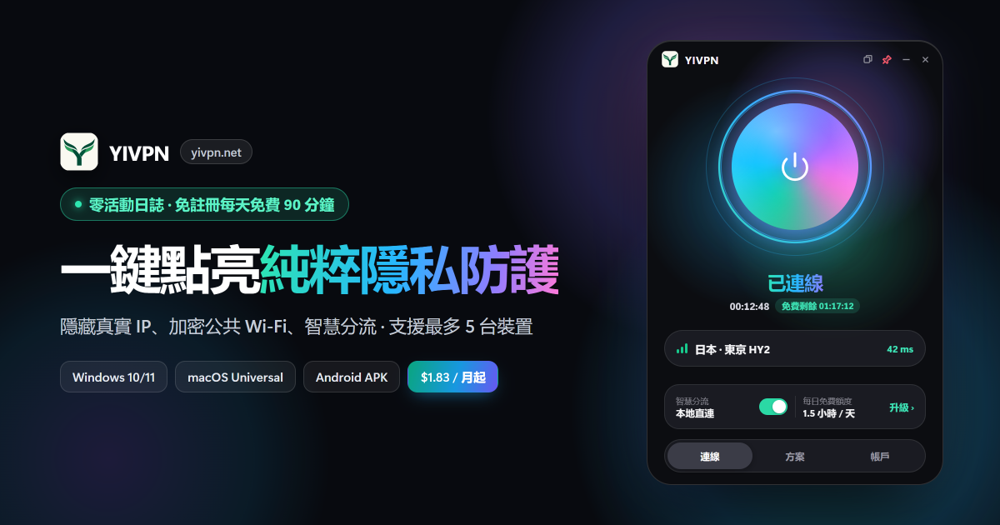

<p align="center">
  <a href="https://yivpn.net/zh-tw/">
    
  </a>
</p>

<h1 align="center">YIVPN（易VPN）｜零日誌隱私加密 VPN · 每天免費 90 分鐘</h1>

<p align="center">
  [简体中文](./README.zh-CN.md) · [繁體中文](./README.zh-TW.md) · [English](./README.md) · [Русский](./README.ru.md) · [日本語](./README.ja.md) · [한국어](./README.ko.md) · [Español](./README.es.md) · [Français](./README.fr.md) · [Deutsch](./README.de.md) · [Português](./README.pt.md) · [Italiano](./README.it.md) · [Türkçe](./README.tr.md)
</p>

<p align="center">
  <a href="https://github.com/yivpn-official/yivpn/releases/tag/v1.0.4"></a>
  <a href="https://github.com/yivpn-official/yivpn/actions/workflows/verify.yml"></a>
  <a href="https://yivpn.net/zh-tw/security/"></a>
  <a href="https://yivpn.net/zh-tw/"></a>
</p>

---

YIVPN（易VPN）零活動日誌輕量 VPN：隱藏真實 IP、加密公共 Wi-Fi，免註冊免綁卡每天免費 90 分鐘，支援智慧分流與 5 台裝置，月費 $2.99 起。

- **嚴格零活動日誌**
- **免註冊每天免費 90 分鐘**
- **最多 5 台裝置同時防護**

## 全平台官方下載 (v1.0.4)

| 支援平台 | 官網高速直連 | GitHub Release 下載 | SHA-256 雜湊校驗 |
| :--- | :--- | :--- | :--- |
| **Windows 10 / 11 (64-bit)** | [`YIVPN_1.0.4_x64.msi`](https://yivpn.net/downloads/YIVPN_1.0.4_x64.msi) (30.73 MiB) | [Download from GitHub](https://github.com/yivpn-official/yivpn/releases/download/v1.0.4/YIVPN_1.0.4_x64.msi) | `b2f5e30da9b40bca…` ([full](https://github.com/yivpn-official/yivpn/releases/download/v1.0.4/YIVPN_1.0.4_x64.msi.sha256)) |
| **Windows 10 / 11 Portable (64-bit)** | [`YIVPN_1.0.4_x64_portable.zip`](https://yivpn.net/downloads/YIVPN_1.0.4_x64_portable.zip) (30.28 MiB) | [Download from GitHub](https://github.com/yivpn-official/yivpn/releases/download/v1.0.4/YIVPN_1.0.4_x64_portable.zip) | `4a7dcd2461b5b982…` ([full](https://github.com/yivpn-official/yivpn/releases/download/v1.0.4/YIVPN_1.0.4_x64_portable.zip.sha256)) |
| **macOS 11+ (Apple Silicon & Intel Universal)** | [`YIVPN_1.0.4_universal.dmg`](https://yivpn.net/downloads/YIVPN_1.0.4_universal.dmg) (66.02 MiB) | [Download from GitHub](https://github.com/yivpn-official/yivpn/releases/download/v1.0.4/YIVPN_1.0.4_universal.dmg) | `606998242b90b8b0…` ([full](https://github.com/yivpn-official/yivpn/releases/download/v1.0.4/YIVPN_1.0.4_universal.dmg.sha256)) |
| **Android 7.0+ (ARM64-v8a)** | [`YIVPN-Android-1.0.4-arm64-v8a.apk`](https://yivpn.net/downloads/YIVPN-Android-1.0.4-arm64-v8a.apk) (87.00 MiB) | [Download from GitHub](https://github.com/yivpn-official/yivpn/releases/download/v1.0.4/YIVPN-Android-1.0.4-arm64-v8a.apk) | `5e2a768d67d4378e…` ([full](https://github.com/yivpn-official/yivpn/releases/download/v1.0.4/YIVPN-Android-1.0.4-arm64-v8a.apk.sha256)) |
| **iOS & iPadOS (15+)** | *iOS Coming Soon* | [Follow Releases](https://github.com/yivpn-official/yivpn/releases) | — |

## 安裝檔完整性驗證 (SHA-256)

```bash
# PowerShell (Windows)
Get-FileHash .\YIVPN_1.0.4_x64.msi -Algorithm SHA256

# macOS / Linux
shasum -a 256 YIVPN_1.0.4_universal.dmg

# Verify all published release manifests & remote SHA-256 digests
node scripts/verify-releases.mjs --remote
```

## 每日免費額度與方案

- **每日免費方案 · $0** — 每天 1.5 小時（90 分鐘）零日誌加密連線 · 內建智慧分流 · 免填信箱免綁卡下載即用
- **1 個月方案**: **$2.99** (30 天全天候防護 · $2.99 / 月 · 約 $0.10 / 天)
- **3 個月方案**: **$6.99** (90 天全天候防護 · $2.33 / 月 · 約 $0.08 / 天)
- **6 個月方案**: **$12.99** (180 天全天候防護 · $2.17 / 月 · 約 $0.07 / 天)
- **12 個月方案**: **$21.99** (365 天全年隱私無憂 · 每月僅 $1.83 · 每天僅 $0.06)

## 官方連結

- **YIVPN 官方網站**: [https://yivpn.net/zh-tw/](https://yivpn.net/zh-tw/)
- **下載與校驗中心**: [https://yivpn.net/zh-tw/download/](https://yivpn.net/zh-tw/download/)
- **每天免費 90 分鐘（免註冊）**: [https://yivpn.net/zh-tw/free-vpn/](https://yivpn.net/zh-tw/free-vpn/)
- **零日誌與安全架構**: [https://yivpn.net/zh-tw/security/](https://yivpn.net/zh-tw/security/)
- **隱私權政策**: [https://yivpn.net/zh-tw/privacy/](https://yivpn.net/zh-tw/privacy/)
- **Smart Split Rules (Open Source)**: [github.com/yivpn-official/singbox-smart-split](https://github.com/yivpn-official/singbox-smart-split)
- **Local VPN MCP Server (Claude Code / Codex)**: [https://yivpn.net/zh-tw/vpn-mcp/](https://yivpn.net/zh-tw/vpn-mcp/)
- **Agent VPN API & CLI (Open Source)**: [github.com/yivpn-official/yivpn-agent-cli](https://github.com/yivpn-official/yivpn-agent-cli)
